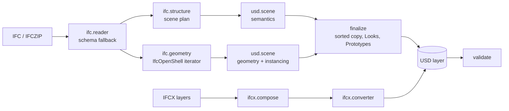

# Contributing

Contributions are welcome: bug reports with sample files, mapping
improvements, documentation and tests.

## Development setup

```bash
git clone https://github.com/isaddiq/ifcusd.git
cd ifcusd
python -m venv .venv
.venv/Scripts/activate            # Windows; source .venv/bin/activate on macOS/Linux
python -m pip install -e ".[dev]"
python -m pip install -r website/requirements.txt   # only to work on the website
```

## Checks

```bash
python -m pytest -q                       # full test suite
python -m ruff check .                    # lint
python -m ruff format --check .           # formatting (ruff format . to fix)
mkdocs serve -f website/mkdocs.yml        # website at http://127.0.0.1:8000
mkdocs build --strict -f website/mkdocs.yml   # what the website workflow runs
```

The test suite builds its IFC models with IfcOpenShell's authoring API
(`tests/model_factory.py`). The same feature-rich model is generated in
IFC2X3, IFC4 and IFC4X3, so no third-party sample files are needed. The tests
cover:

* every property kind, units, type inheritance and relationships, for all three schemas;
* completeness (`validate_usd(..., source=...)`) and coverage accounting;
* world-space geometry against IfcOpenShell to 10⁻⁴ m;
* byte-identical output across thread counts;
* the Omniverse and Unity profiles, `.usdz`, filters, schema fallback and `.ifczip`;
* IFC5 composition, layering, references and point clouds;
* the CLI, the schema plugin (in a fresh process) and the bundled samples.

CI runs them on Linux and Windows for Python 3.10 – 3.14.

## Architecture



| Module | Responsibility |
| --- | --- |
| `ifcusd.converter` | orchestration, report and coverage accounting |
| `ifcusd.ifc.reader` | opening files, schema fallback, header, georeferencing |
| `ifcusd.ifc.structure` | the scene plan: parents, prim types, kinds, names, relationship classification |
| `ifcusd.ifc.properties` | property and quantity extraction with full typing |
| `ifcusd.ifc.values`, `ifc.units` | EXPRESS value → USD type mapping; unit labels |
| `ifcusd.ifc.styles` | IFC surface styles → PBR material descriptions |
| `ifcusd.ifc.geometry` | tessellation through IfcOpenShell |
| `ifcusd.usd.scene` | writing the plan, property sets, relationships, geometry, instancing |
| `ifcusd.usd.sdf`, `usd.geometry`, `usd.materials` | Sdf-level authoring helpers |
| `ifcusd.ifcx` | IFC5 composition and conversion |
| `ifcusd.schema` | the codeless USD schema plugin |
| `ifcusd.validate` | validation and completeness checks |

Three rules keep the output reproducible:

1. Everything that becomes a prim is planned, sorted and named before
   anything is written.
2. Geometry arrives from worker threads in any order. It is written to a
   scratch layer and copied into the output in sorted order.
3. Names are derived from content (GlobalIds, style names, geometry ids),
   never from processing order.

## Changing the mapping

* Describe the change in `website/docs/reference/schema-mapping.md` first.
* Update `src/ifcusd/schema/resources/*` if declared attributes change, and
  bump `SCHEMA_VERSION` in `src/ifcusd/_version.py` when the written
  structure changes.
* Add a test in `tests/test_conversion.py` that checks the new output for all
  three schemas.

## Releasing

1. Update `__version__` in `src/ifcusd/_version.py` and add a section to the
   changelog page, `website/docs/about/changelog.md`.
2. Commit, tag (`git tag v1.0.1`) and push the tag.
3. Create a GitHub release from the tag. The *Upload Python Package* workflow
   runs the tests, builds the wheel and sdist, and publishes to PyPI through
   trusted publishing (configure the `pypi` environment and the trusted
   publisher on PyPI once).

## Documentation website

Everything for the website lives in `website/`, separate from the Python
package. It is a static site (HTML, CSS and JavaScript only) generated with
[MkDocs Material](https://squidfunk.github.io/mkdocs-material/):

```text
website/
  mkdocs.yml          configuration: theme, navigation, extensions
  requirements.txt    build tools (not needed to use the package)
  docs/               the pages
    index.md          landing page
    getting-started/  installation, quick start, tutorial
    guide/            CLI, Python API, output, targets, validation, IFC5, recipes, troubleshooting
    reference/        mapping specification, USD schema, file formats, API reference
    about/            existing methods, contributing, changelog, license and citation
    assets/           logo and favicon
    stylesheets/      theme colours and landing-page styles
```

Preview with live reload, or build exactly as CI does:

```bash
python -m pip install -r website/requirements.txt
mkdocs serve -f website/mkdocs.yml               # http://127.0.0.1:8000
mkdocs build --strict -f website/mkdocs.yml      # output in website/site/ (git-ignored)
```

`--strict` turns every warning, including broken links and anchors, into an
error. `reference/usd-schema.md` and `about/citation.md` include the schema
file, `LICENSE` and `CITATION.cff` from the repository, so they never go out
of date.
`.github/workflows/docs.yml` builds it and deploys it to GitHub Pages on every
push to `main`; GitHub only runs workflows from `.github/workflows/`, so that
file sits outside `website/`.

One-time setup in the repository: **Settings ▸ Pages ▸ Build and deployment ▸
Source: GitHub Actions**.

The API reference is generated from docstrings by mkdocstrings, so keep
public docstrings in Google style.
