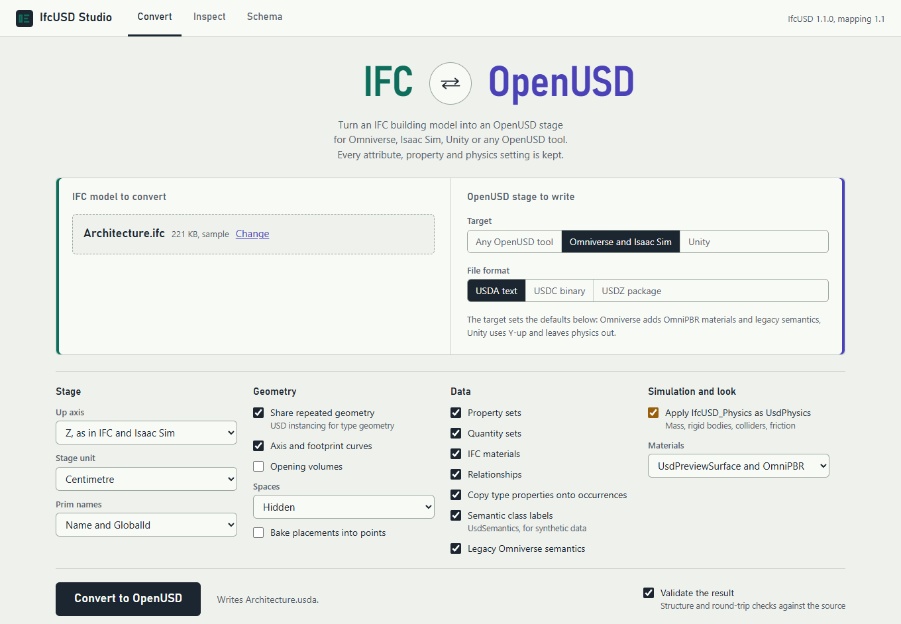
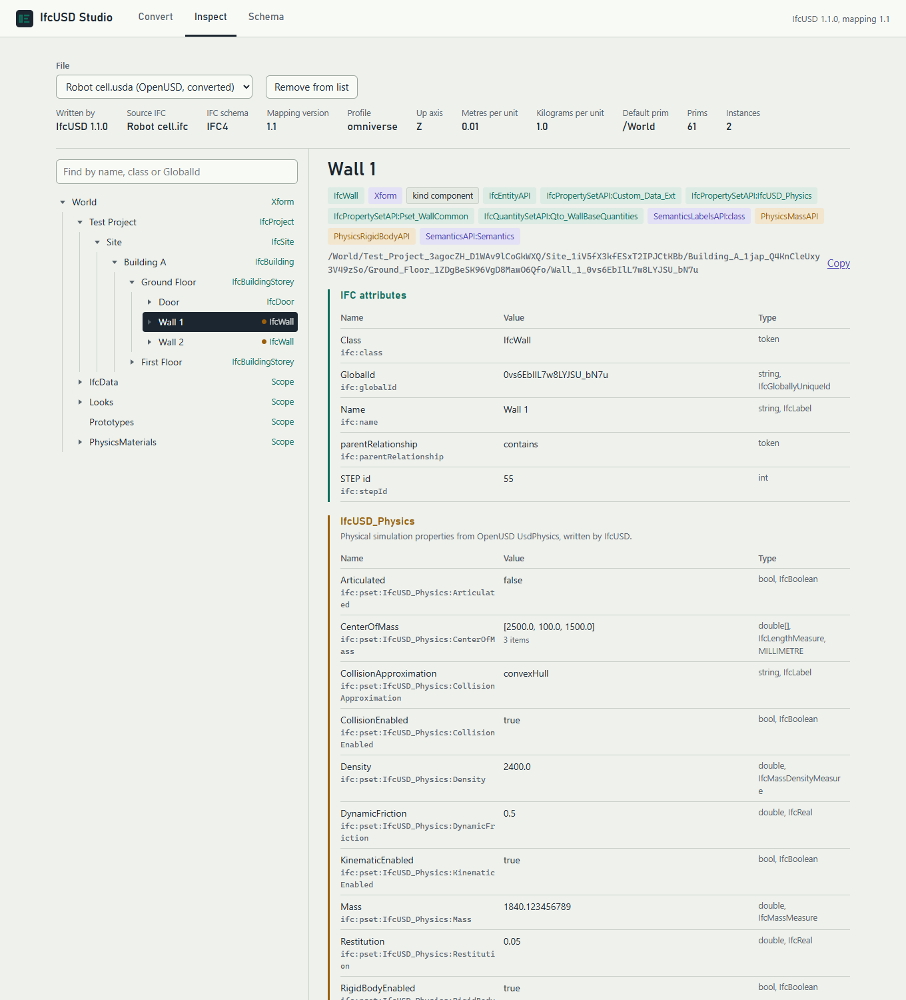

# IfcUSD Studio

IfcUSD Studio is a browser UI for IfcUSD. It converts IFC to OpenUSD and back
with the same options as the command line, and lets you browse what is in a
file: the spatial structure, IFC attributes, property sets, physics and the
USD schemas behind them. It runs on your computer, and your files stay there.



## Start it

=== "Installed with pip"

    ```bash
    ifcusd ui
    ```

    `ifcusd-studio` does the same.

=== "From a source checkout"

    ```bash
    python app.py
    ```

    This needs IfcUSD's dependencies (`pip install ifcopenshell usd-core numpy`)
    but not IfcUSD itself. If one is missing, `app.py` offers to install it
    with pip for the Python you ran it with (`--install-deps` installs without asking).

Your web browser opens at `http://127.0.0.1:8765/`, or the next free port if
that one is taken. The terminal shows the address and the folder where
converted files are kept. Press ++ctrl+c++ in the terminal to stop the Studio.

| Option | Description |
| --- | --- |
| `--port N` | Port to listen on (default 8765). |
| `--no-browser` | Do not open the browser; open the printed address yourself. |
| `--workspace DIR` | Folder for uploaded and converted files (default: `ifcusd-studio` in the system's temporary folder). |
| `--host ADDRESS` | Address to listen on. The default, `127.0.0.1`, accepts this computer only. See [Privacy](#privacy). |

## Convert

The two words at the top show the direction. Use the button between them to
swap between **IFC → OpenUSD** and **OpenUSD → IFC**.

You can pick a file in four ways:

* drop it on the box, or use **Choose file**: the file is copied to the workspace;
* reuse a file that is already in the Studio, such as one you just converted;
* click a sample model (when running from a source checkout);
* paste a path on this computer: the file is read where it is, not copied,
  which is quicker for large models.

**IFC → OpenUSD.** Pick a target (*Any OpenUSD tool*, *Omniverse and Isaac
Sim* or *Unity*) and a file format (`.usda` text, `.usdc` binary or a `.usdz`
package). The target sets the option defaults, the same way
[`--profile`](cli.md#target-and-scene) does. You can then change the stage
unit, up axis, geometry, data and physics options. To start Isaac Sim with
the physics an earlier run stored in IFC, keep **Apply IfcUSD_Physics as
UsdPhysics** on.

**OpenUSD → IFC.** Add any edit layers, such as one saved from Isaac Sim. The
last layer is the strongest. Then either pick the IFC model the stage was
converted from, which writes only what changed into a copy of it
(`<name>.updated.ifc`), or build a new model in IFC4, IFC4X3 or IFC2X3. The
options match [`ifcusd to-ifc`](cli.md#ifcusd-to-ifc).

**Validate the result** runs [`ifcusd validate`](validation.md) on a new USD
stage, or IfcOpenShell's schema validation on a new IFC file.

The result shows the conversion summary and counts, any warnings and the
validation outcome. From there you can download the file or the JSON report,
copy the path of the saved file (to open it straight in Isaac Sim or
usdview), or open the result under **Inspect**. A reload keeps the latest
result in view.

## Inspect



Pick any file in the Studio. The header shows the key facts: for a USD stage,
which IfcUSD version wrote it, the source IFC and schema, the mapping
version, profile, up axis and units; for IFC, the schema, the authoring tool
and units. With nothing selected, the right side summarises the file's
contents: IFC classes, prim types, physics schemas and property sets.

On the left is the structure: the prim hierarchy of a USD stage, or the
spatial structure of an IFC model (project, site, building, storeys and
their elements). Elements outside the spatial structure are listed under
*Not in the spatial structure*. A dot marks elements with physics. Search
finds elements by name, IFC class or GlobalId. Arrow keys move through the
tree.

Selecting an element shows its data, grouped by origin and coloured to match:

* **IFC attributes** and **property sets** (teal);
* **IfcUSD_Physics** and, on a USD prim, the native **Physics (UsdPhysics)**
  attributes right after it (amber), so you can compare both forms;
* quantity sets, robot and simulation data, semantic labels, and geometry and
  transform attributes;
* applied API schemas, relationships and bound render and physics materials.
  Selecting a relationship target opens that prim.

Values show their USD type, IFC measure type and unit. Long arrays show their
first items and their length. Attributes with time samples show the first
sample. Only authored values are listed, not schema defaults.

## Schema

The **Schema** tab summarises how IFC is written in OpenUSD, how physics
travels in both directions, the API schemas of the
[IfcUSD schema plugin](../reference/usd-schema.md) with every property, and
the [IFC extension](../reference/ifc-extension.md) property sets. It is read
from the installed package, so it always matches the IfcUSD version that is
running.

## Privacy

The Studio listens on `127.0.0.1` by default, so only this computer can reach
it. Each session has a random token that only the Studio's own page receives,
and requests for any other host name are refused. Other web pages open in
your browser therefore cannot use it.

Uploaded and converted files are kept in the workspace folder until you
remove them (**Remove from list** under Inspect). Files you opened by path
are only read; removing them from the list leaves them on disk.

With `--host 0.0.0.0` other computers on your network can use the Studio and
convert files on this one. Opening files by path is then switched off. Use
it only on a network you trust.
